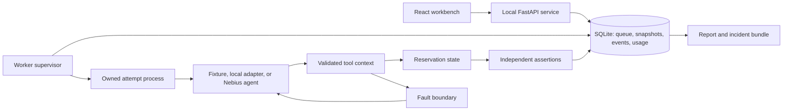

# Architecture and security

## Truth and observation

Authoritative state is distinct from the result returned to the agent. The verifier knows expected state; it is not supplied through tool observations. Trusted custom Python can introspect its process, so this is a correctness boundary, not adversarial isolation.

API idempotency prevents duplicate submissions; a worker token fences late writes; an operation key implements business idempotency. Infrastructure does not silently deduplicate repeated business actions.

`tool_requested` records the decision before execution. `tool_effect` checkpoints a returned effect and state, even if cancellation arrived during the call. `tool_observed` records the raw response after fault injection. `agent_observed` records the response actually delivered after any runtime safeguards. A crash between execution and persistence makes the attempt inconclusive. No automatic replay of uncertain work occurs.

## Lifecycle

SQLite uses WAL and atomic claims. One worker lease is active. Heartbeats renew a 20-second lease; expired owners are fenced and their runs marked interrupted. Comparison metadata and jobs commit atomically.

The supervisor launches a bounded attempt process. Cancellation permits a two-second grace period for a cooperative call to checkpoint before stopping the owned process. Timeouts still enforce the attempt deadline, and unconfirmed inference charges remain reserved. A child liveness watchdog exits if its supervisor disappears and never renews the absent parent's lease. This does not prevent trusted Python from creating subprocesses or accessing the machine; hostile code execution is unsupported.

Custom adapters are imported through explicit CLI use. General workers skip jobs needing an unavailable adapter. Adapter import itself is trusted local Python.

Snapshots freeze scenario, policy, initial-state hash, tool schema, model/prices, verifier version, and fault schedule. Explicit occurrence numbers define fault boundaries; seeds identify scenario variants and do not make model output deterministic.

Execution states: queued, running, completed, failed, infrastructure_failed, cancelled, interrupted. Verdicts: passed, failed, safe_incomplete, inconclusive. Infrastructure failure cannot become an agent pass. Cancelled runs may contain committed effects.

Playback reads recorded events. Regression replays recorded decisions without a model. Fresh evaluation never caches responses. A changed policy can invalidate a recorded final claim; only fresh agent execution evaluates prompt repairs.

## Threat boundaries

- Localhost API, host validation, cross-origin write rejection, payload limits, safe rendering, and CSP.
- No shell/import tools available to the built-in agent.
- No API key in browser state, snapshots, logs, or provider error messages.
- Export redacts known keys, common tokens, sensitive fields, and email addresses. This is best effort, not complete PII detection. Redacted bundles cannot establish exact replay.
- No pickle or unsafe YAML object loading. ZIP replay reads bounded fixed members without extraction.
- Integer-microdollar accounting with atomic reservations and evidence-backed reconciliation.
- Public access, authentication, tenant isolation, arbitrary uploaded code, and production-connected tools are outside the beta.

Do not expose the server through a public tunnel. Complete production gates before shared hosting.
